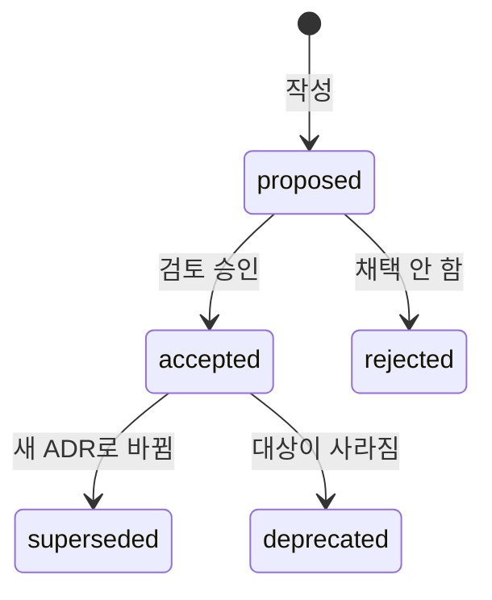

# ADR 작성 가이드

ADR(Architecture Decision Record)은 **결정 하나**를 **왜 그렇게 정했는지**와 함께 짧게 남기는 문서입니다. 형식은 널리 쓰이는 MADR(Markdown ADR)을 우리 문서 규칙에 맞게 줄인 것입니다.

---

## 1. 언제 쓰나

다음 중 하나라도 해당하면 씁니다.

- 되돌리기 비싸거나, 다른 팀·다른 사람의 작업에 영향을 주는 결정
- 그럴듯한 대안이 있었고, 그 대안을 **버린 이유**가 나중에 궁금해질 결정
- 같은 질문("왜 호스트에 ROS를 안 깔고 컨테이너를 써요?")이 두 번 이상 나온 결정
- 외부 기준(장비, entropos, 다른 팀)을 따르기로 하거나 따르지 않기로 한 결정

쓰지 않는 것:

- 구현 세부(변수 이름, 함수 분리)나 언제든 바꿀 수 있는 설정값
- 결정이 아니라 **절차**인 것 → 실행 가이드(`guides/`)나 설계 문서
- 아직 조사 중인 것 → 설계 문서의 "결정 필요" 항목으로 두고, 결론이 나면 ADR

## 2. 파일과 번호

| 규칙 | 예 |
| --- | --- |
| 위치: `docs/adr/` | |
| 파일 이름: `NNNN-짧은-영문-제목.md` (네 자리 번호, 소문자, `-`) | `0004-vendor-third-party-configs.md` |
| 번호: 지금 가장 큰 번호 + 1. 한 번 쓴 번호는 **재사용하지 않음** (기각·폐기된 ADR도 남김) | |
| 첫 제목: `# ADR-NNNN. <결정 문장>` (파일 번호와 같아야 함) | `# ADR-0004. 외부 설정 파일을 저장소에 복사해 쓴다` |

메뉴, [목록](README.md), [의사결정 로그](log.md), [아키텍처 (C4)](c4.md)의 표시는 **자동으로** 갱신됩니다. 파일만 추가하면 됩니다.

## 3. 머리말 (front matter)

파일 맨 위 `---` 사이에 씁니다. 웹 페이지에서는 제목 아래 **상태 카드**로 보이고, 목록 표에도 쓰입니다.

| 필드 | 필수 | 값 |
| --- | --- | --- |
| `status` | ○ | `proposed`(제안), `accepted`(승인), `rejected`(기각), `deprecated`(폐기), `superseded`(대체됨) |
| `date` | ○ | 마지막으로 **상태가 바뀐** 날, `YYYY-MM-DD` |
| `deciders` | ○ | 결정에 동의한 사람 목록, `[이름, 이름]` |
| `summary` | ○ | [의사결정 로그](log.md)에 들어갈 **한 줄 요약**. 40자 안팎, "무엇을 어떻게"만 (예: `개발 도구를 호스트 설치 대신 Docker 개발 컨테이너에서 실행`) |
| `c4` | | 이 결정이 걸린 아키텍처 요소 id 목록, `[dev-container]`. id는 `docs/adr/c4-model.yml`에 있는 것만 (§9) |
| `area` | ○ | 프로젝트의 분야 id 하나. 목록은 프로젝트 `docs-kit.yml`의 `areas`(아래 표) |
| `supersedes` | | 이 ADR이 대체하는 ADR 번호 목록, `[3]` |
| `superseded_by` | `superseded`일 때 ○ | 새 ADR 번호, `7` |
| `related` | | 함께 읽을 ADR 번호 목록, `[1, 2]` |

필수 필드가 없거나 값이 목록에 없으면, 사이트를 빌드할 때 로그에 `WARNING`이 나옵니다(`.docs-kit/bin/docs.sh logs`). 분야 목록은 프로젝트마다 `docs-kit.yml`의 `areas`에서 정합니다(ADR·VR·실험이 같은 목록을 씀). 이 프로젝트의 값:

<!-- kit-areas -->

## 4. 본문 각 절 쓰는 법

순서와 제목은 [템플릿](template.md)을 그대로 따릅니다. 전체 분량은 **한두 화면**이 목표입니다. 길어지면 결정을 둘로 나눕니다.

| 절 | 쓸 것 | 피할 것 |
| --- | --- | --- |
| 제목 | 결정 자체를 "~한다"로. 읽기만 해도 무엇을 정했는지 알 수 있게 | "개발 환경 검토", "Docker에 대해" 같은 주제명 |
| 배경 | 결정이 필요해진 상황, 그 시점의 사실과 제약. 버전·숫자에는 출처 | 결론을 미리 말하기 |
| 결정 요인 | 선택지를 가르는 **기준**, 중요한 순서로 3~5개 | 특정 선택지에 유리하게 만든 기준 |
| 고려한 선택지 | 실제로 가능했던 대안 2~4개를 `### 번호. 이름`으로. 각각 **장점**, **단점**, **기각 사유**(고른 것은 제목에 `(채택)`, **채택 이유**). 기각 사유는 결정 요인 번호와 이어지게. "아무것도 안 함"도 대안이 될 수 있음 | 허수아비 대안, 장점 없는 대안, 고른 것만 단점 없이 쓰기 |
| 결정 | 고른 선택지 + 결정 요인에 비춘 이유 1~3문장 | 배경 반복 |
| 선택지 비교 | 결정 요인 × 선택지 표. 칸에는 ○/△/×와 짧은 이유 | 이유 없는 기호만 |
| 결과 | 좋아지는 점, **감수할 점**(대가), 후속 작업 | 좋은 점만 쓰기 |
| 재검토 조건 | 결정을 다시 볼 구체적인 계기 | "필요하면 재검토" |
| 참고 | 설계 문서 절, 장비 조회 결과, 외부 자료 | |

문장 규칙은 다른 문서와 같습니다.

- 사실과 추정을 구분합니다. 확인하지 않은 것은 "확인하지 않음", "추정"이라고 씁니다.
- 다른 문서의 절은 `12 §2.2`(문서 번호 두 자리 + §절 번호)처럼 쓰면 웹에서 자동으로 링크됩니다([문서 사이트 사용법](../docs-kit.md)).
- `docs/` 밖의 파일은 링크 대신 코드 경로(`` `docker/dev/Dockerfile` ``)로 씁니다.

## 5. 상태 흐름과 고치는 규칙

- **승인된 ADR의 본문은 고치지 않습니다.** 결정이 바뀌면 새 ADR을 쓰고, 새 ADR에 `supersedes: [N]`, 옛 ADR에 `status: superseded`, `superseded_by: M`을 적습니다. 옛 ADR에서 바꾸는 것은 머리말뿐입니다.
- 오타, 깨진 링크, 사실과 다르지 않은 표현 수정은 언제든 고칩니다.
- 템플릿 형식이 바뀌었을 때 기존 ADR을 새 형식으로 옮기는 정리도 고칠 수 있습니다. 단, 결정·선택지·이유의 **내용은 그대로** 두고 배치와 표현만 바꿉니다. 커밋 메시지에 "형식 정리"라고 적습니다.
- `proposed` 상태에서는 검토 의견에 따라 본문을 자유롭게 고칩니다.
- `date`는 상태가 바뀔 때만 갱신합니다.

## 6. 작성과 검토 순서

1. 템플릿을 복사해 다음 번호로 파일을 만들고, `status: proposed`로 씁니다.
2. 웹 미리보기(`.docs-kit/bin/docs.sh start` 상태에서 저장)로 상태 카드와 목록 표가 맞게 나오는지, 로그에 `WARNING`이 없는지 봅니다.
3. 검토를 요청합니다(Claude 또는 팀원). 검토 기준은 아래 §7입니다.
4. 합의되면 `status: accepted`, `date`를 그날로, `deciders`를 채우고 커밋합니다.
5. 관련 설계 문서에 "결정 근거: ADR-NNNN" 링크를 답니다.

## 7. 검토 체크리스트

- [ ] 제목만 읽어도 무엇을 정했는지 알 수 있다
- [ ] 결정이 하나다 (두 개면 나눈다)
- [ ] 배경의 사실에 출처(문서 절, 장비 조회, 버전)가 있다
- [ ] 선택지가 실제로 가능했던 대안이고, 각각 장점·단점·기각 사유가 있다 (고른 것도 단점을 적는다)
- [ ] 결정 이유가 결정 요인과 이어진다
- [ ] 감수할 점이 적혀 있다
- [ ] 재검토 조건이 구체적이다 (사건·단계·버전으로 판단 가능)
- [ ] `summary`만 읽어도 결정을 알 수 있다
- [ ] `c4`에 결정이 실제로 영향을 주는 요소가 들어 있다 (없으면 모델에 요소를 추가할지 검토)
- [ ] 머리말 필드가 맞고, 빌드 로그에 `WARNING`이 없다
- [ ] 설계 문서와 내용이 어긋나지 않는다 (어긋나면 어느 쪽을 고칠지 정한다)

## 8. 동작 원리 (관리자용)

| 파일 | 역할 |
| --- | --- |
| docs-kit `site/src/lib/records.ts`, `nav.ts` | 메뉴 자동 구성, 목록 표(`README.md`의 `<!-- adr-index -->`), 의사결정 로그(`log.md`의 `<!-- adr-log -->`), C4 그림·요소 표(`c4.md`의 `<!-- c4-view: <id> -->`, `<!-- c4-elements -->`), 상태 카드 삽입, 머리말·모델 검사 |
| `docs/adr/c4-model.yml` | C4 요소·관계·그림 정의 (§9) |
| docs-kit `site/public/_kit/kit.css` | 상태 카드, 상태 배지, C4 뷰어 삽입 모양(밝은/어두운 색) |
| docs-kit `assets/adr/viewer/` | 아키텍처 뷰어(별도 전체 화면 페이지): `index.html`, `viewer.css`, `viewer.js`. 배치는 ELK(`elkjs`, 버전은 사이트 잠금 파일), 선은 직각 경로로 카드를 피해 감. 데이터 `viewer/data.json`은 빌드할 때 만들어짐(저장소에 없음) |
| 프로젝트 `docs-kit.yml` | ADR 탭 켜기(`features`), 분야 목록(`areas`). 메뉴를 직접 정할 때 `nav`의 `ADR` 항목은 비워 두면 키트가 채움 |

키트의 `site/` 코드를 고친 뒤에는 서버를 다시 시작해야 반영됩니다(`.docs-kit/bin/docs.sh stop && .docs-kit/bin/docs.sh start`). ADR 파일을 추가·수정하는 것은 재시작 없이 바로 반영됩니다.

## 9. 아키텍처 (C4) 모델 관리

[아키텍처 (C4)](c4.md) 페이지의 대화형 그림은 손으로 그리지 않고 `docs/adr/c4-model.yml`에서 만들어집니다. 그림의 배치(위치)는 매번 자동으로 계산되므로 좌표를 적지 않습니다. 구조가 바뀌면 이 파일만 고칩니다.

| 항목 | 쓰는 법 |
| --- | --- |
| `elements` | `id`(영문 소문자·`-`, 바꾸지 않음), `name`, `kind`(`person`, `system`, `container`, `component`), `parent`(상위 요소 id), `technology`, `description`, `external: true`(다른 팀·외부 소유, 하위 요소에 상속) |
| `relations` | `{from, to, label, tech, kind}`. 값에 `,`가 있으면 따옴표로 감쌈 (`tech: "EtherCAT, CAN-FD"`). `kind`: `flow`(기본, 실선: 늘 지나는 길. 한 요소에 실선이 여럿 들어오면 모두 필요), `alt`(점선: 경우에 따라 이 길 중 하나, 택1), `call`(짧은 점선, 양쪽 화살표: 불러 쓰고 답을 받음. 계산 도구·라이브러리) |
| `views` | 그림 하나. `scope`가 없으면 최상위 요소만 그리는 컨텍스트 그림, `scope: <id>`면 그 요소의 하위 요소를 점선 상자 안에 그리고 바깥과의 관계를 함께 그림. `include: [<id>, ...]`로 그 안의 일부만 그릴 수 있고, 빠진 형제 요소 중 관계가 있는 것은 흰 점선 상자로 표시됨. 바깥 요소는 최상위 시스템으로 합쳐 그림(`outside: elements`면 합치지 않고 그 요소 이름 그대로). `direction: DOWN`이면 위에서 아래로(기본 왼쪽에서 오른쪽). 페이지에 넣으려면 `c4.md`에 `<!-- c4-view: <view id> -->` |

규칙:

- **요소 id는 바꾸지 않습니다.** ADR의 `c4:`가 id로 가리키므로, 바꾸면 링크가 끊깁니다(빌드 로그에 `WARNING`). 이름은 자유롭게 바꿔도 됩니다.
- 하위 요소끼리의 관계는 상위 그림에서 자동으로 상위 요소 사이의 관계로 합쳐집니다. 컨텍스트 그림용 관계를 따로 쓰지 않습니다.
- 새 결정이 모델에 없는 요소에 걸리면, ADR을 쓰면서 요소를 먼저 추가합니다. 같은 커밋에 넣습니다.
- 한 그림에 컨테이너가 7개를 넘으면 글자가 작아져 읽기 어렵습니다. `include`로 나눠 그립니다.
- Component(Level 3) 그림이 필요해지면 컨테이너 아래에 `kind: component` 요소를 추가하고 `scope: <컨테이너 id>`인 view를 만듭니다.
