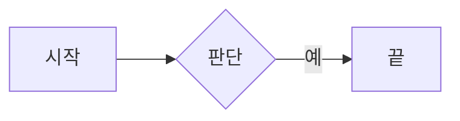

# G2. Markdown 문법 시험

> 기준: 2026-01-12

이 페이지는 docs-kit이 받는 Markdown 문법(prd.md FR-MD)을 한곳에 모은 고정 입력입니다. 같은 절 참조 §2.1, 배경 참조 01 §1, 가이드 참조 G1 §2.

## 1. 알림과 접는 상자

!!! tip "도움말 제목"
    알림 상자 본문의 **굵은 글씨**와 `코드`.

    - 목록 하나
    - 목록 둘

!!! warning
    제목 없이 종류 이름만.

??? info "접힌 상자"
    처음에는 닫혀 있습니다.

???+ note "열린 상자"
    처음부터 열려 있습니다.

    !!! danger "안쪽 상자"
        중첩된 알림.

## 2. 내용 탭과 표

### 2.1 내용 탭

=== "첫째 탭"
    첫째 탭 내용.

=== "둘째 탭"
    둘째 탭 내용과 코드:

    ```bash
    echo "hello"
    ```

### 2.2 표와 속성

| 번호 | 이름 |
| --- | --- |
| 2.2.1 | 표 행 앵커 |

강조할 문단입니다.
{: .kit-test-para #para-id }

[속성 링크](../README.md){: .kit-test-link }

## 3. 수식, 그림, 작업 목록

수식 $E = mc^2$ 과 블록 수식:

$$
\int_0^1 x\,dx = \frac{1}{2}
$$



- [x] 끝난 일
- [ ] 남은 일

들여쓴 코드 블록 앞 문단:

    indented code block (4 spaces)

## 4. 끼워 넣기와 개발 전용

--8<-- "guides/_snippet.txt:part"

;--8<-- "guides/_snippet.txt:part"

<div class="kit-dev-only" markdown>
개발 미리보기에서만 보이는 **Markdown** 블록.
</div>

<!-- short-links -->

## 5. C4 그림 넣기

<!-- c4-view: context height=360 -->
